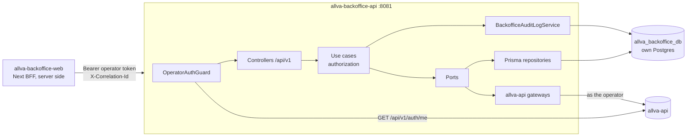

# Allva Backoffice API — Architecture

> How `allva-backoffice-api` is built today. Every path cited exists.
> **Last audited against the code:** 2026-10-16, branch `main`, commit `5f13e9b`.
> Where this document and the code disagree, the code wins and this document must be fixed.

See also: [Agent Instructions](../AGENTS.md) · [Product Requirements](./PRD.md) · [Engineering Rules](./RULES.md) · [Project Memory](./MEMORY.md) · [Specification](./backoffice-api.md)

Status markers: `[IMPLEMENTED]` `[PARTIAL]` `[PLANNED]` `[DECISION]` `[CONSTRAINT]` `[VERIFY]`

---

## 1. Architecture Overview



- One NestJS process, stateless except for an in-memory introspection cache.
- Two hard dependencies, both required at boot: its **own Postgres** (`DATABASE_URL`) and **`allva-api`** (`ALLVA_API_URL`).
- No background jobs, queues, schedulers, cache servers or outbound integrations besides `allva-api` (see [MEMORY.md §18](./MEMORY.md#18-planned--not-yet-implemented)).

---

## 2. Technology Stack

| Concern | Choice |
|---|---|
| Runtime | Node 22 (Docker `node:22-alpine`) |
| Framework | NestJS 11 (`@nestjs/platform-express`) |
| Language | TypeScript 5.9 |
| ORM | Prisma 7.3, `prisma-client` generator → `generated/prisma`, `@prisma/adapter-pg` driver adapter |
| Database | PostgreSQL 15 |
| Validation | class-validator / class-transformer (HTTP), zod (env) |
| Security headers | helmet |
| API docs | `@nestjs/swagger` (`/docs`, `/docs-json`) + Scalar (`/scalar`, `public/scalar.html`) |
| Tests | Jest 29 + ts-jest |
| Package manager | pnpm 8.15.5 (`packageManager` field) |

---

## 3. Repository Structure

```text
src/
  main.ts                 bootstrap: Swagger, listen
  configure-app.ts        pipeline: trust proxy, helmet/CSP, CORS, static, ValidationPipe, exception filter
  app.module.ts           module graph + CorrelationIdMiddleware
  modules/<module>/       one bounded area each (§5)
  shared/
    domain/repositories/pagination.ts
    infrastructure/
      allva-api/          AllvaApiClient (HTTP transport only)
      config/             env schema (zod), EnvService, docs visibility
      context/            correlation id middleware + AsyncLocalStorage
      database/           PrismaService, JSON helper
      http/               client IP, global exception filter, PageQueryDto
prisma/                   schema.prisma, migrations/
test/
  architecture/           structural gates
  support/test-env.ts     throwaway env for specs
public/scalar.html
generated/prisma/         generated client (git-ignored)
```

---

## 4. Application Layers

```text
<module>/
  <module>.module.ts
  domain/            entities, pure rules, ports (abstract class) — no Nest, Prisma, express
  application/       use cases, DTOs, presenters, *-access helpers — talk to ports only
  infrastructure/
    database/prisma/   repositories / readers
    providers/         HTTP gateways to allva-api
    http/controllers/  thin controllers
```

Dependency direction: `infrastructure → application → domain`. Enforced by `test/architecture/layering.spec.ts`. Ports are bound to implementations in each `*.module.ts` with `{ provide: XInterface, useClass: XPrismaRepository }`.

Allowed cross-module dependencies (current):

- every module → `auth/domain` (`Operator`, permissions) and `auth/application` (`assertPlatformPermission`);
- writing modules → `audit/application` (`BackofficeAuditLogService`);
- controllers → `auth/infrastructure` (`@CurrentOperator`, `@Public`);
- `operations-hub` infrastructure → `support/domain` (`LIVE_TICKET_STATUSES`, `SLA_AT_RISK_WINDOW_MS`) so hub counts and queue use the same SLA rule.

---

## 5. Module Map

| Module | Owns | Tables | Talks to `allva-api` |
|---|---|---|---|
| `auth` | Operator identity, global guard, permission vocabulary, refusal | — | `GET /api/v1/auth/me` |
| `audit` | Internal audit trail | `backoffice_audit_logs` | — |
| `operations-hub` | Internal hub signals | reads `ticket_sla_snapshots`, `alert_events`, `alert_rules` | — |
| `support` | SLA policies, snapshots, queue, assignment history, metrics | `sla_policies`, `ticket_sla_snapshots`, `ticket_assignment_events` | `GET /api/v1/admin/support/tickets`, `GET`/`PATCH /api/v1/admin/support/tickets/:id` |
| `internal-notes` | Operator notes on product subjects | `internal_notes` | — |
| `preferences` | Operator preferences, saved views | `operator_preferences`, `saved_views` | — |
| `alerts` | Alert rules, alert events, acknowledgement | `alert_rules`, `alert_events` | — |
| `contract-drafts` | Pre-signature drafts and conversion | `contract_drafts` | `POST /api/v1/admin/contracts` |
| `health` (flat) | Load-balancer probe | — | — |

### 5.1 Routes

All routes require a Bearer operator except `health` and docs. "Audit" is the `action` recorded.

| Method & path | Access decided in the use case | Audit |
|---|---|---|
| `GET /api/v1/health` | `@Public()`; checks own DB only | — |
| `GET /api/v1/hub/attention` | any operator; signals filtered by `operator.can` | — |
| `GET /api/v1/support/queue` | `support:read` | — |
| `GET /api/v1/support/tickets/:ticketId` | `support:read` | — |
| `POST /api/v1/support/tickets/:ticketId/assignment` | `support:manage` | `support.ticket.assigned` |
| `GET /api/v1/support/sla-policies` | `support:read` | — |
| `POST /api/v1/support/sla-policies` | `settings:manage` | `support.sla_policy.created` |
| `PATCH /api/v1/support/sla-policies/:id` | `settings:manage` | `support.sla_policy.updated` |
| `GET /api/v1/support/metrics` | `support:read` | — |
| `GET /api/v1/notes?subjectType&subjectId` | subject permission; filtered by `visibilityPermission` | — |
| `POST /api/v1/notes` | subject permission (+ must hold the restriction set) | `internal_note.created` |
| `PATCH /api/v1/notes/:id` | visible + subject permission + author or `settings:manage` | `internal_note.updated` |
| `DELETE /api/v1/notes/:id` | same as PATCH; soft delete | `internal_note.deleted` |
| `GET /api/v1/me/preferences` | own data | — |
| `PUT /api/v1/me/preferences` | own data | `operator_preferences.updated` |
| `GET /api/v1/views?screen` | screen permission; list filtered by it | — |
| `POST /api/v1/views` | screen permission | `saved_view.created` |
| `PATCH /api/v1/views/:id` | owner + screen permission | `saved_view.updated` |
| `DELETE /api/v1/views/:id` | owner + screen permission | `saved_view.deleted` |
| `GET /api/v1/alert-rules` | `settings:read` | — |
| `POST /api/v1/alert-rules` | `settings:manage` | `alert_rule.created` |
| `PATCH /api/v1/alert-rules/:id` | `settings:manage` | `alert_rule.updated` |
| `GET /api/v1/alerts` | any operator; filtered to rules whose `required_permission` they hold | — |
| `POST /api/v1/alerts/:id/acknowledge` | the rule's `required_permission` | `alert_event.acknowledged` |
| `GET /api/v1/contract-drafts`, `GET /:id` | `billing:read` | — |
| `POST /api/v1/contract-drafts` | `billing:manage` | `contract_draft.created` |
| `PATCH /api/v1/contract-drafts/:id` | `billing:manage`; `409` if converted | `contract_draft.updated` |
| `POST /api/v1/contract-drafts/:id/convert` | `billing:manage`; idempotent | `contract_draft.converted` |
| `GET /api/v1/audit-logs` | `audit:read` | — |
| `/docs`, `/docs-json`, `/scalar` | public when docs enabled | — |

---

## 6. Request Lifecycle

```text
CorrelationIdMiddleware      honour X-Correlation-Id (≤200 chars) or generate; AsyncLocalStorage
  → helmet / CSP / CORS      (configure-app.ts)
  → OperatorAuthGuard        @Public? docs path? else Bearer → AuthenticateOperatorUseCase → request.operator
  → ValidationPipe           transform, whitelist, forbidNonWhitelisted → 400 VALIDATION_ERROR
  → Controller               @CurrentOperator(), DTO; calls one use case
  → Use case                 access decision → ownership/visibility → domain → ports → audit
  → Presenter                entity → *OutputDto
  → GlobalExceptionFilter    HttpException body as-is; other errors → 500 (message hidden in production)
```

---

## 7. Authentication

`OperatorAuthGuard` is registered as `APP_GUARD` in `auth.module.ts`. It only authenticates. `AllvaApiOperatorIdentityGateway`:

- calls `GET /api/v1/auth/me` with a **2 s** timeout;
- caches conclusive results for `OPERATOR_INTROSPECTION_CACHE_MS` (default and max 60 000; `0` disables), keyed by SHA-256 of the token, sweeping expired entries above 1 000 entries;
- maps: incomplete payload or `platformRole: null` ⇒ `NOT_OPERATOR` (403); upstream 401 ⇒ `UNAUTHENTICATED` (401); anything else ⇒ `UNAVAILABLE` (503).

`Operator` (`auth/domain/entities/operator.entity.ts`) carries `id`, `name`, `email`, `platformRole` (display/audit only), `permissions`, `accessToken`, and `can(permission)`.

---

## 8. Authorization

- `assertPlatformPermission(operator, 'x:y')` — typed literal; throws `403 ACCOUNT_NOT_AUTHORIZED` with `details.permission`.
- `platformPermissionDenied(permission)` — same refusal when the permission comes from data (alert rule, note restriction).
- `operator.can(...)` — filtering (hub, alerts list, notes list, views list).
- `assertScreenAvailable` (preferences) — `404 SAVED_VIEW_SCREEN_NOT_AVAILABLE` for a screen the operator lacks.
- `findVisibleNote` / `assertCanChangeNote` (internal-notes), `findOwnedView` (preferences) — visibility and ownership.
- Use cases exempt from a permission check are listed with a reason in `OWN_DATA_USE_CASES` (`test/architecture/authorization.spec.ts`): get/update operator preference, authenticate operator.

---

## 9. Data Ownership & Isolation

Operators have no active organization, so there is no tenant column. Isolation is:

- **by permission** — subject permission on notes, screen permission on views, rule permission on alerts, signal permission on the hub;
- **by operator** — preferences keyed by the token's operator id; views changeable only by their owner; the `assigned_to_me_waiting` signal;
- **by system** — product data stays in `allva-api` and is read with the operator's own bearer, so `allva-api` applies its own guards. `organizationId` here is only a queue filter forwarded to `allva-api`.

---

## 10. Database

Own Postgres `allva_backoffice_db` (local: `docker-compose.yml`, port 5433). All ids are UUID strings. No FK to product data; the only FK is `alert_events.rule_id → alert_rules.id` (`onDelete: Cascade`).

| Table | Key | Notes |
|---|---|---|
| `ticket_assignment_events` | `id` | `ticket_id`, from/to operator, `actor_id`, `reason` |
| `sla_policies` | `id` | partial unique index `sla_policies_one_active_per_scope` on `(priority, COALESCE(category,''))` where `active` — **migration only** |
| `ticket_sla_snapshots` | `ticket_id` | deadlines, first reply, resolution, escalation columns (never written today) |
| `internal_notes` | `id` | subject, author, `visibility_permission`, soft delete |
| `operator_preferences` | `operator_id` | one row per operator |
| `saved_views` | `id` | JSON `filters`/`columns`/`sort` |
| `alert_rules` / `alert_events` | `id` | events have no producer yet |
| `contract_drafts` | `id` | JSON `terms`, envelope fields, `contract_id` after conversion |
| `backoffice_audit_logs` | `id` | append-only |

"Enum-like" columns (`status`, `priority`, `channel`, `subject_type`, `severity`) are `String` in Postgres; the allowed values live in TypeScript (`as const` arrays) and DTOs. There are no Prisma enums and no `$transaction` usage.

Prisma: generator `prisma-client` → `generated/prisma`; datasource URL comes from `prisma.config.ts` (driver adapter pattern — no `url` in the schema). `PrismaService` builds a `PrismaPg` adapter, SSL off for `localhost`, `rejectUnauthorized: false` otherwise.

---

## 11. `allva-api` Integration

`AllvaApiClient` (`shared/infrastructure/allva-api/allva-api.client.ts`) is transport only:

- adds `Authorization: Bearer <operator token>`, `Accept`, `User-Agent: allva-backoffice-api/1.0`, `x-correlation-id`;
- default timeout 5 s (`AbortSignal.timeout`); no retries;
- network failure/timeout ⇒ `503 PRODUCT_API_UNAVAILABLE`; non-2xx ⇒ `HttpException` with **the upstream status and body** (so a product `403` keeps its `details.permission`).

Each module defines a port in `domain/ports/` and a gateway in `infrastructure/providers/`:

| Gateway | Calls | Notes |
|---|---|---|
| `AllvaApiOperatorIdentityGateway` | `GET /api/v1/auth/me` | §7 |
| `AllvaApiSupportTicketsGateway` | `GET /api/v1/admin/support/tickets`, `GET`/`PATCH .../:id` | maps a subset of `AdminSupportTicketOutputDto`; list responses carry no messages (`messages: null`), detail does |
| `AllvaApiContractsGateway` | `POST /api/v1/admin/contracts` | missing `id` in the response ⇒ `502 PRODUCT_API_UNEXPECTED_RESPONSE` |

---

## 12. Support / SLA Engine

- Pure rules in `support/domain/sla.ts` (`now` is always a parameter): states `BREACHED` / `AT_RISK` (within 2 h) / `ON_TRACK`; live statuses `OPEN`, `IN_PROGRESS`; `resolveSlaTargets` = priority+category policy → generic priority policy → `FALLBACK_SLA_TARGETS`.
- `TicketSlaSnapshot.open` fixes deadlines from `createdAt`; `observe` updates status/priority/assignee/last message and never touches deadlines.
- `TicketSlaTrackerService.track(tickets)` is the only writer of snapshots: 3 queries per page (active policies, existing snapshots, `saveMany`). Called by the queue, the ticket detail and the assignment.
- Queue: see [MEMORY.md §9](./MEMORY.md#9-support-sla-queue-assignment-metrics) for the two pagination modes.
- Metrics: assignment count and SLA compliance %; other fields `null` `[PARTIAL]`.

---

## 13. Operations Hub

`GetOperatorAttentionUseCase` filters `SUPPORT_ATTENTION_SIGNALS` by permission, then `AttentionCountsPrismaReader` counts each signal in isolation (`Promise.allSettled`) from `ticket_sla_snapshots`; a failed count is omitted and returned as `count: null`. `alerts.unacknowledged` is one signal per (rule permission, severity) with unacknowledged events. Sorted by severity, stable within catalog order.

| Key | Permission | Severity |
|---|---|---|
| `support.sla_breached` | `support:read` | CRITICAL |
| `support.sla_at_risk` | `support:read` | WARNING |
| `support.escalated` | `support:read` | WARNING |
| `support.assigned_to_me_waiting` | `support:read` | INFO |
| `alerts.unacknowledged` | the rule's | the event's |

---

## 14. Audit & Logging

`BackofficeAuditLogService.record({ actor, action, subjectType, subjectId, before?, after?, reason?, ip?, userAgent? })` wraps repository `save` in try/catch and logs `audit.record_failed …` on failure. Nest `Logger` is the only logger; no structured log transport is configured. The exception filter logs unexpected `500`s with stack.

---

## 15. API Conventions

- Every route under `/api/v1/`, written in the `@Controller(...)` itself (no global prefix).
- Pagination: `PageQueryDto` (`page` ≥ 1, `pageSize` 1–100, default 20) → `{ items, total, page, pageSize }`.
- Errors: `{ code, message, details? }` (validation adds `field`), codes in `SCREAMING_SNAKE_CASE`.
- Swagger tags/operations on controllers; `@ApiBearerAuth()` on protected controllers.

---

## 16. Environment Configuration

Validated by `envSchema` (`shared/infrastructure/config/env.ts`) at boot.

| Variable | Required | Default | Purpose |
|---|---|---|---|
| `DATABASE_URL` | yes | — | own database |
| `ALLVA_API_URL` | yes | — | identity, permissions, product data |
| `NODE_ENV` | no | `development` | |
| `PORT` | no | `8081` | |
| `FRONTEND_URL`, `CORS_ALLOWED_ORIGINS` | no | — | production CORS allowlist |
| `TRUSTED_PROXIES` | no | 1 hop | Express `trust proxy` |
| `DOCS_ENABLED` | no | off in production | Swagger/Scalar |
| `OPERATOR_INTROSPECTION_CACHE_MS` | no | `60000` (max) | introspection cache TTL |

---

## 17. Security

Helmet baseline (HSTS 180 d, `no-referrer`, `nosniff`, frame deny); strict CSP (`default-src 'none'`) except on docs paths; CORS permissive outside production, allowlist in production, `X-Correlation-Id` allowed/exposed; whitelist validation; tokens never cached in clear; `500` messages hidden in production. No rate limiting `[PLANNED]`.

---

## 18. Testing

- Jest, `rootDir: src`, roots `src` + `test`; `testRegex: .*\.spec\.ts$`; `test/support/test-env.ts` as setup.
- **No infrastructure:** no spec opens a DB connection or calls `allva-api`.
- Co-located unit specs (8 suites) cover SLA rules and snapshot, alert event, internal note, operator authentication, hub attention, queue, assignment.
- Architecture gates (4 suites) in `test/architecture/`: `layering`, `authorization`, `routes`, `application-graph`.
- No e2e or integration suite.

---

## 19. Build & Deployment

- `pnpm build` = `nest build` into `dist/` (`prebuild` cleans). Start: `node dist/src/main`.
- `Dockerfile`: two stages on `node:22-alpine`; production stage installs prod deps, copies `prisma/` and `prisma.config.ts` (needed by `migrate deploy`), `dist/`, `public/`; port 8081.
- CI (`.github/workflows/ci.yml`, push to `main` and PRs): `verify` = install → `prisma generate` → `typecheck` → `lint:ci` → `test:cov`; `migrations` = `migrate deploy` on a clean Postgres 15 → `migrate diff --exit-code`.
- Deploy (`.github/workflows/deploy.yml`): **manual only**; GCP `allva-staging`, `southamerica-east1`, Cloud Run service `allva-backoffice-api`, migrate job run before the service deploy, secrets `BACKOFFICE_DATABASE_URL`, `BACKOFFICE_ALLVA_API_URL`.

---

## 20. Architectural Decisions & Debt

Decisions and their reasons: [MEMORY.md §15](./MEMORY.md#15-decisions-that-should-not-be-accidentally-reversed). Debt and limitations: [MEMORY.md §16–17](./MEMORY.md#16-known-technical-debt).
